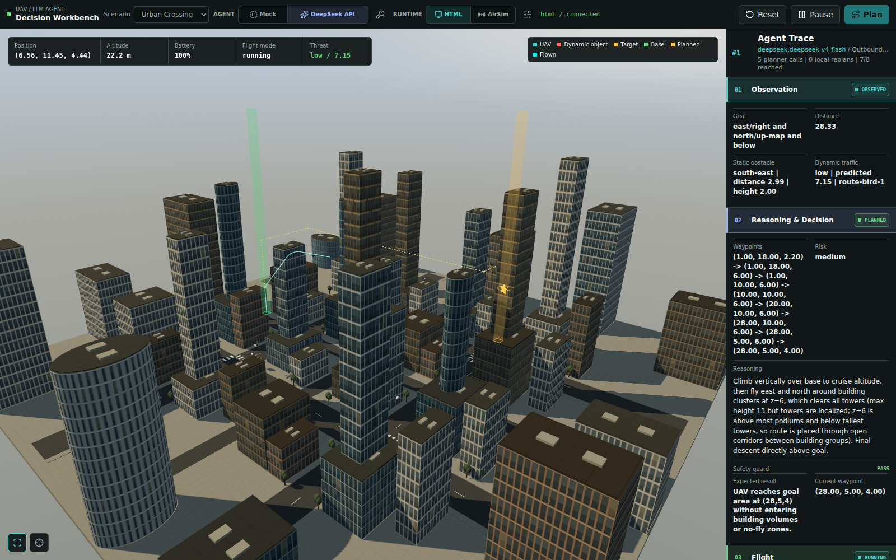

# UAV LLM 决策 Demo

这个项目展示 LLM 在 UAV 系统中的具体位置：LLM Planner 读取任务和环境观测，一次输出经过安全校验的 waypoint 序列；连续运动控制器负责速度、加速度和 waypoint tracking；选中的 Runtime 负责执行并返回状态。LLM 不直接控制电机、姿态环或飞控频率。



DeepSeek API 模式下的 Urban Crossing 实际飞行画面（HTML Simulation）。

```text
            Mock / DeepSeek LLM
                    |
                LLM Planner
                    |
       SafetyChecker / WaypointManager
                    |
          TrajectoryController
                    |
          -----------------------
          |                     |
     HTML Runtime          AirSim Runtime
   默认可视化执行器       可选最终验证环境
```

## Runtime

`HTML Simulation` 是默认模式。它不启动 Unreal、不连接 `41451`，由 `TrajectoryController` 以 50 ms 控制周期连续更新位置、速度和加速度，适合开发 Planner、观察决策日志和验证任务逻辑。

无人机从基地地面（z=0）启动，先垂直爬升，再执行三维航路；返航先到基地上空，再垂直下降，低速到达地面才完成任务。巡航高度为 10–50 米，低于 10 米仅允许在基地半径 0.75 米的起降柱内运动。城市及空旷场景取消强制等高路线，允许按建筑约束爬升、下降或绕行；窄走廊场景保留 10–12 米的专用低空约束。控制器限制爬升 2 米/秒、下降 1 米/秒；这是仿真参数，不代表真实机型性能。

目标点不再固定：启动、Reset 和切换场景时，随机选择地图内的安全三维目标（城市及空旷场景高度采样 10–30 米，窄走廊保持 10 米），城市目标与基地的水平距离至少 75 米，并排除起飞所在的近端区域；其他场景至少 30 米，不把高度差算入距离。Reset 不重复上一个目标，任务运行、暂停/继续、重新规划及 Agent 切换不改变目标；Runtime 切换保留当前目标以便验证同一任务。本地规划器只检查候选目标是否可达，校验路线不会被装载或执行，实际任务路线仍由选中的 Mock/DeepSeek 生成。手动 `/api/mission/goal` 只修改当前任务目标，下次 Reset 仍生成随机目标。Benchmark 用场景 seed 固定目标随机序列，并在结果中记录目标坐标。

城市 HTML 场景包含 8 个动态障碍：4 只鸟在 8–12 米高度自由巡游，另外 4 只在任务航路附近的安全区域穿行，高度随三维路线变化。自由巡游速度上限为 2–4 米/秒，路线巡游为 1.6–2.4 米/秒；路线空间不足时改为普通巡游。起停和窄弯会减速。路径考虑鸟类半径、建筑、禁飞区和地图边界；可行转弯使用连续曲线，否则在安全折点减速。后端发布带时间基准的真实轨迹段供浏览器渲染；避障器只接收当前鸟类位置和速度，按匀速外推，不读取未来轨迹。当前状态仍是仿真提供的理想观测，尚未模拟传感器噪声、遮挡和速度估计误差。无人机暂停或等待 API 时鸟类仍运动，Reset 会重新随机生成。

路线巡游初始位置参考本地静态可达路线，实际接受 Mock/DeepSeek 航路后只调整未来运动段，不瞬移、不追踪无人机位置来强制碰撞。巡游横穿区域的中心距基地和任务终点至少 12 米；普通巡游不设这些禁入区。该交通用于避障演示，严格固定交通的算法对比应使用普通巡游场景。

终点的实际高度处显示金色星星与光环。后端确认抵达后播放上升、散射粒子和 `★ +1` 提示，返航仍继续；每轮只收集一次，刷新不重播，Reset 恢复。

普通巡游允许进入目标点和基地附近；鸟类只受建筑、场景禁飞区、地图边界和自身飞行高度限制。随机目标的可达性检查仅针对静态环境，不承诺动态障碍物持续占据目标时一定能到达。

鸟类显示头部、尖喙、尾羽、振翅与滑翔；鼠标指向鸟类显示编号、高度和安全范围，接近无人机时显示琥珀色或红色提示。`LocalAvoidance` 在每个控制周期推演未来 3 秒的相对运动，沿用速度/加速度限制，检查建筑、边界和附近鸟类，并增加随预测时间增长的经验安全余量（并非概率安全保证）。水平、升降与斜向绕行同时评分，低空飞行作为偏好；安全的已有绕行每 0.5 秒重新评分，明显更优时才切换，遇险立即重选。距最终航点 6 米内检查 6 秒的接近、减速及至少 0.75 秒稳定停留，目标受阻时保留安全等待/绕行选择。橙色虚线和 `LOCAL AVOIDANCE` 表示临时避障航段。

执行期间每 0.25 秒检查安全的前向航点连接，跳过已无必要的普通中间航点，不要求绕行后折返。每条连接同时通过静态全航段和动态短时运动检查；最终目标必须低速到达。`flight.skipped_waypoints` 记录当前计划跳过的点数，Planner 原始航点仍保留。`metrics.path_length` 按水平每格 3 米、高度每层 5 米换算，`path_length_unit` 为 `m`。

HTML 飞行保护启用后，`metrics.collision_or_separation_events` 根据连续控制采样间的相对运动检查 UAV 与鸟类安全包络是否重叠，同一次持续重叠只计一次，不再搜索决策文本。`min_dynamic_clearance_m` 为最小包络净距，负值表示间距违规，并不等于已确认的网格模型物理碰撞；未测量时为 `null`。`evaluation.dynamic_incidents` 保留最近 100 次事件的鸟类编号、任务时间和净距，累计计数不受截断影响。页面事件列表在 Reset 后清除；通过 `app.py` 启动时，运行记录异步写入 `logs/mission_runs.jsonl`，可按 `run_id` 复盘，详见下方评测说明。

点击 Start 后启用本地保护：暂停任务、等待 API 或 Planner 连续失败时仍可主动躲避来袭鸟类，但不擅自继续已暂停/失败的任务。Reset、任务完成及飞控/连接故障会解除保护。短暂相遇只进行本地轨迹重规划，不消耗 API；局部避障期间剩余路线长度连续 8 秒无明显改善才请求高层重规划，动态事件调用间隔至少 10 秒，网络故障按 2、4、8、16、30 秒退避并持续重试；重复不安全路线保留拒绝航段与次数，要求更换走廊，重试间隔最多 10 秒。均不设尝试次数上限，直到成功或手动暂停、Reset。找不到无碰撞轨迹时显示红色 best-effort 告警并选择风险较低且不穿建筑的运动，不能保证任意突发情况绝对无碰撞。这是有限时域仿真避障，不是真机安全认证。AirSim 尚未接入鸟类遥测，不使用 HTML 鸟类冒充其障碍物。

`AirSim Validation` 是可选模式。启动 Blocks 后，在同一页面切换即可。切换 Runtime 会停止自动运行并从基地重置任务，不会把 HTML 中途状态同步给 AirSim。连接失败时仍保留当前 HTML Runtime 和任务状态。

AirSim 模式下，浏览器 Three.js 只保留静态任务地图、目标和基地，不显示 UAV、动态飞行物，也不回放 AirSim 返回的轨迹。实际飞行只发生在 Blocks 中；浏览器继续显示 AirSim 遥测、Planner 决策和执行结果。HTML 与 AirSim 是同一个控制层的两个 Runtime，不是先执行 HTML 再同步到 AirSim。

AirSim 会执行 NED 路径并返回位置、姿态、线速度、角速度、线加速度和角加速度。短航段速度上限、实际位置重定基准和稳定到达判定仍由 `airsim_runtime.py` 负责。

`Urban Crossing` 使用 40×40 格（117×117 米）的任务地图，保留近端街区，并向远端扩展为 32 个地块、4 个十字路口；道路、街树、建筑和安全检查使用相同场景数据。起终点以同色的透明方形光柱标记，可透过建筑辨认位置。HTML 使用高低错落的现代楼群（最高 65 米），包括矩形、圆柱塔楼及局部斜撑立面，配合细密窗格、屋顶设备、道路纹理和暖色侧光；街树低于最低飞行高度。建筑造型及屋顶细节均限制在共享障碍包围体内，圆柱的碰撞检查采用保守包围体；任务边界外的楼群只作视觉背景。AirSim 仍按 `scene_layout.py` 将同一占地单元显示为简化方盒，本轮未进行 AirSim 联机建模或验证。水平每格 3 米，高度每层 5 米。

切入 AirSim 或切换场景时，程序用本机 Blocks 的 Cube 资源生成地图并加载纯色贴图。共享地图位于 NED `(500, 500, -100)` 的独立区域，避免与原装 Blocks 建筑重叠；飞行指令和遥测统一加减该偏移。Reset 将无人机放回该地图基地。原装 Blocks 地图保留，仅更新 `UAVDemo_` 前缀的对象。目前共享贴图要求 Blocks 与 Flask 同机运行；动态飞行物的真实 Unreal 运动/碰撞仍属于独立功能，不由静态地图统一提供。

HTML 中 UAV 和鸟类共用仿真时钟，页面只读取快照；暂停任务或等待 API 时，控制循环仍更新交通和本地保护。慢帧最多推进 0.1 仿真秒，因此两者一起减慢；超过 0.3 秒记录延迟而不中断 HTML 任务，AirSim 保留超时保护。页面分别显示去程到达、返航完成和重试状态；只有实际位置及速度满足条件才确认任务阶段。

## 安装（WSL）

在 VS Code 中打开 WSL / Ubuntu（Bash）终端；如果当前是 PowerShell，先输入 `wsl`。运行以下命令无需额外插件。

进入项目目录，首次使用时安装依赖：

```bash
cd "/mnt/c/Users/kyrie/Documents/New project 3"
bash scripts/setup_wsl.sh
```

Linux 环境位于 `~/.venvs/uav-llm-demo`，无需手动激活；项目内的 Windows `.venv` / `.venv-airsim` 不用于 WSL。

## 启动（WSL）

在 WSL 终端执行：

```bash
cd "/mnt/c/Users/kyrie/Documents/New project 3"
bash scripts/start_demo.sh
```

打开 [http://127.0.0.1:5000](http://127.0.0.1:5000)，保持启动终端打开。若提示 5000 已被占用，先停止原服务再启动。

### 页面操作

默认使用 `HTML Runtime` 和 `Mock Agent`，可在工具栏切换 `Mock / DeepSeek API`；AirSim 验证步骤见下文。`Plan` 生成路线，`Start` 开始或暂停任务，`Reset` 重置任务并随机更换目标；暂停任务后 Flask 服务仍运行。

任务默认往返：到达目标并减速稳定后自动进入 `Returning`，根据当前位置和环境重新规划回基地的路线；返回基地上空、下降到地面并低速稳定后才标记 `Completed`。保留完整往返轨迹，返程同样支持暂停、继续、三维绕行与动态避障。DeepSeek 正常往返至少规划两次，安全重规划可能增加调用次数。

## Agent

默认 Agent 是离线 `mock`。DeepSeek 与 Runtime 相互独立：DeepSeek 可以驱动 HTML，也可以驱动 AirSim。

不要把 API key 写入代码或提交到 Git。推荐在页面工具栏点击 `DeepSeek API`，再点击钥匙按钮输入 key。key 只保存在当前 Flask 进程内存，重启 Flask 后清除；页面、日志和 API 响应不会回显 key。

DeepSeek 请求失败时，页面只显示不含响应正文的 HTTP 状态码或网络故障类别。认证失败、余额不足和参数错误会立即停止，不再重复请求；网络故障（含 TLS）、超时、限流及服务端错误按 2、4、8、16、30 秒退避并持续重试，成功后重置间隔。原始响应正文和异常文本不会写入任务轨迹。当前默认模型名 `deepseek-v4-flash` 仍被官方接受；新推荐名是 `deepseek-flash`，可通过 `DEEPSEEK_MODEL` 设置。

DeepSeek 路线未通过安全检查时，使用最新观测和拒绝原因继续请求，不自动切换 Mock。等待期间保持本地避障；持续重试可能增加 API 用量，可在页面暂停或 Reset 取消。

WSL 下 DeepSeek 请求由 Linux `requests` 发出，网络与代理设置应在 WSL 中生效。

也可以在启动前通过环境变量预置 key；这不是必需步骤，Agent 模式仍在浏览器中切换：

```bash
read -rsp 'DeepSeek API key: ' DEEPSEEK_API_KEY; echo
export DEEPSEEK_API_KEY
export DEEPSEEK_MODEL='deepseek-v4-flash'
bash scripts/start_demo.sh
```

输入 key 时不会回显，也不会将 key 写入命令历史。使用环境变量预置的 key 会保留在当前终端中，需要清除时执行 `unset DEEPSEEK_API_KEY`。

## DeepSeek Prompt Cache

请求按固定 System 规则、Scene 地图、Mission 目标、State 当前状态、Feedback 重试反馈排序。地图 JSON 使用稳定的字段和障碍物顺序；完整地图仍随请求发送，由 DeepSeek 自动复用前缀。

通过 `app.py` 启动后，每次 DeepSeek 请求的数值统计写入 `logs/deepseek_usage.log`（JSON Lines，2 MB 轮转，保留 3 个备份）。记录 `prompt_tokens`、`prompt_cache_hit_tokens`、`prompt_cache_miss_tokens`、输出 token 数、耗时和 HTTP 状态；不记录 key、Authorization、原始 Prompt 或模型回复。没有返回 usage 的请求保留空值，不当成零命中。`common_prefix_content_chars` 是本地字符比较，不是缓存命中 token 数。

统计连续请求时使用加权命中率 `sum(hit) / sum(prompt_tokens)`：

```bash
~/.venvs/uav-llm-demo/bin/python scripts/audit_prompt_cache.py --usage-log logs/deepseek_usage.log
```

脚本按模型及 Prompt 版本汇总，并列出最后 12 条请求；只纳入 token 数完整且 `hit + miss == prompt_tokens` 的样本。缓存落盘需要时间，新前缀应观察至少 3 次连续请求，不能把第一次冷启动或离线字符串相似度当成实测命中率。详细排查见 [Prompt Cache 报告](docs/prompt-cache-audit.md)。

## REST API

```text
GET  /api/state          获取统一任务和 Runtime 状态
POST /api/mission/plan   请求一次高层 waypoint 规划
POST /api/mission/start  开始或继续连续飞行控制循环
POST /api/mission/goal   更新目标并触发重规划
POST /api/reset          重置当前 Runtime 和任务
POST /api/runtime        切换 html 或 airsim，并从基地重置
POST /api/runtime/stop   暂停任务并减速；已启用的本地碰撞保护继续工作
POST /api/runtime/wind   设置 AirSim NED 风速；HTML 返回 HTTP 409
POST /api/config         页面 Agent 切换控件使用的内部接口；日常操作无需手动调用
```

AirSim 切换请求示例：

```json
{
  "backend": "airsim",
  "config": {
    "host": "127.0.0.1",
    "port": 41451,
    "vehicle_name": "Drone1",
    "wind_ned": {"north": 0, "east": 0, "down": 0}
  }
}
```

## 测试（WSL）

在项目目录使用上述 Linux 环境：

```bash
~/.venvs/uav-llm-demo/bin/python -m unittest discover -s tests -v
```

## 评测与复盘

固定种子的离线回归不调用 API：

```bash
~/.venvs/uav-llm-demo/bin/python scripts/run_benchmark.py --mode virtual --scenario open_field --seed 7 --seed 11 --seed 23 --output results.json
```

真实 DeepSeek 评测使用 `--mode realtime --backend deepseek`，需要终端环境变量中的 key；页面内存中的 key 不会传给独立脚本。实时模式计入 API 等待，`--max-seconds` 限制墙钟时间；虚拟模式限制仿真时间，只允许本地或录制的规划响应。超时明确标为 `timeout`。

每轮记录完成证据、延迟、调用量、场景种子及源码指纹。配对比较、离线响应回放和可选费用估算见 [评测与运行日志](docs/evaluation-and-recovery.md)。

## 可选：Windows 本机 AirSim 验证

AirSim 本身支持 Linux；本项目现有 Windows Blocks 与共享贴图入口要求 Flask 在 Windows 运行，以下步骤用于该配置。

在项目目录的 PowerShell 终端指定已安装的 Windows Python 并安装依赖（将示例路径替换为实际解释器）：

```powershell
$env:UAV_DEMO_PYTHON = 'C:\path\to\python.exe'
& $env:UAV_DEMO_PYTHON -m pip install -r requirements.txt -r requirements-airsim.txt
```

确保 5000 端口空闲，再启动 Windows Flask 和 Blocks：

```powershell
powershell -ExecutionPolicy Bypass -File .\scripts\start_demo.ps1
powershell -ExecutionPolicy Bypass -File .\scripts\start_airsim.ps1
```

打开 [http://127.0.0.1:5000](http://127.0.0.1:5000)，等待 Blocks 的 RPC 就绪后，在页面选择 `AirSim Validation`。该入口默认仍使用 HTML Runtime 和 Mock Agent；Windows 下的 DeepSeek 请求使用系统 HTTP 代理设置（包括 PAC），key 可在页面输入。

Windows 本机测试使用与安装依赖相同的解释器：

```powershell
& $env:UAV_DEMO_PYTHON -m unittest discover -s tests -v
```

独立 AirSim 验证：

```powershell
& $env:UAV_DEMO_PYTHON .\scripts\verify_airsim.py
```

## 项目结构

```text
uav_llm_demo/mission_service.py  任务生命周期、控制循环和重规划调度
uav_llm_demo/agents.py           Mock 与 DeepSeek LLM Planner
uav_llm_demo/safety.py           waypoint 和连续路径安全检查
uav_llm_demo/motion.py           waypoint 管理、速度/加速度限制和重规划判定
uav_llm_demo/avoidance.py        本地预测避障、短程绕行和危险缓解
uav_llm_demo/runtime.py          HTML/AirSim 的统一连续运动契约
uav_llm_demo/html_runtime.py     默认连续运动执行器
uav_llm_demo/airsim_runtime.py   AirSim RPC、NED 映射和遥测适配
uav_llm_demo/environment.py      三维任务、建筑和动态飞行物
uav_llm_demo/static/             Three.js 场景和 Runtime 切换 UI
scripts/                         Flask、AirSim 启停和联机验证脚本
tests/                           Runtime、服务、API、飞控和界面契约测试
```
